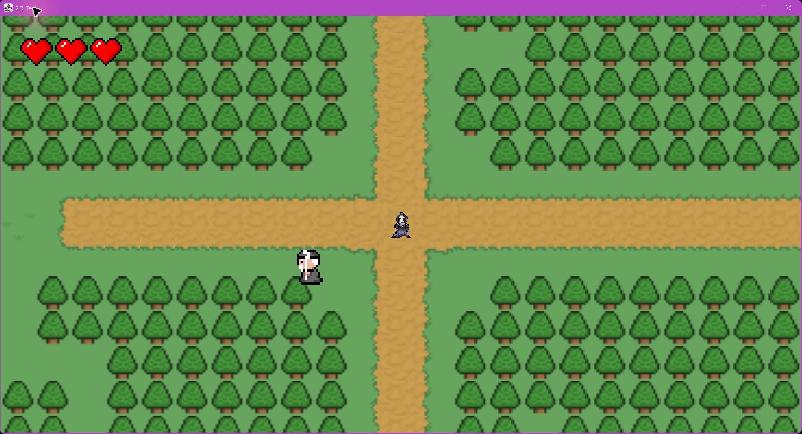
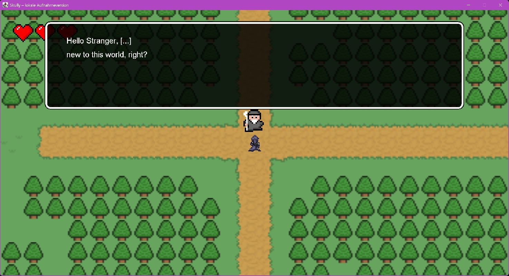
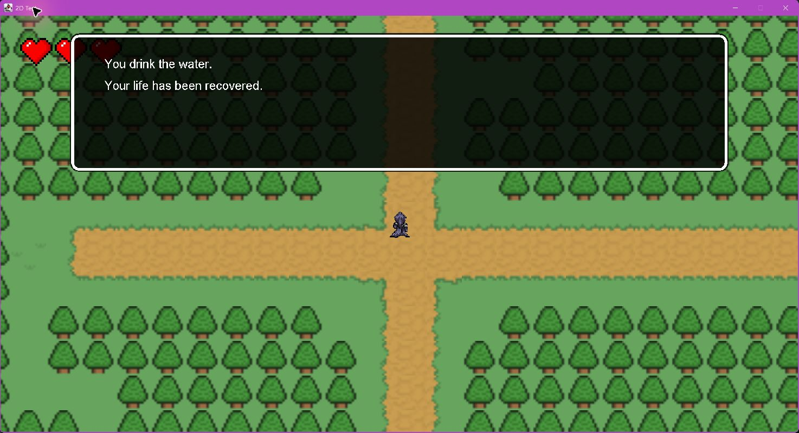
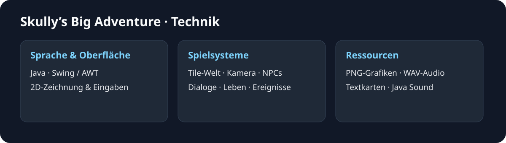

# Skully’s Big Adventure

**2D-Abenteuer · Teamprojekt im Abitur · TGI11 / 2022**

Ein Java-Spielprojekt mit begehbarer Tile-Welt, animierter Spielfigur, NPC-Dialogen und Lebensanzeige. Es entstand als gemeinsame Projektarbeit im Abitur.

[Projekt und Technik](docs/PROJEKT.md) · [Bildergalerie und Versionsvergleich](docs/GALERIE.md) · [Quellcode herunterladen](https://github.com/Kennatris/Skully-s-big-Adventure-2D-RPG-/archive/refs/heads/main.zip)

## Einblick

| NPC-Dialog | Heilereignis |
| --- | --- |
|  |  |

Die Dialogaufnahme wurde mit eingefrorener Zeit und gesetzten Figurenpositionen in einer getrennten lokalen Aufnahmeversion erstellt. Die übrigen Ansichten zeigen das regulär laufende historische Spiel. [Herkunft und weitere Szenen](docs/GALERIE.md).

## Was umgesetzt wurde

- Tile-Welt mit Gras, Wegen, Wasser und Bäumen.
- Bewegungsanimation, Kamera und Kollisionsprüfung.
- NPC-Dialoge, Herzen als Lebensanzeige und Pausenmodus.
- Kartenereignisse für Schaden und Heilung.

## Versionen und Start

Die Bilder oben zeigen den grafisch ausgestalteten Stand unter `Projekt/My2DGame`. Der jüngere Ordner `My2DGame(Test)` und die Root-JAR enthalten einen separaten Teststand mit Platzhalterkacheln. Beide Varianten bleiben im Repository erhalten und werden in der [Galerie getrennt gezeigt](docs/GALERIE.md).

Die [Startanleitung](docs/PROJEKT.md#kompilieren-und-starten) beschreibt beide Varianten. Bewegung: **W/A/S/D**, Start: **Enter**, NPC-Interaktion: **F**, Pause: **Escape**.

> Diese rückblickende Dokumentation wurde automatisiert durch einen Agenten erstellt. Am historischen Spielquellcode wurde nichts geändert. Texte, Technikübersicht und echte Aufnahmen dienen der Veranschaulichung des damaligen Teamprojekts. Alle Angaben und Downloads ohne Gewähr.
