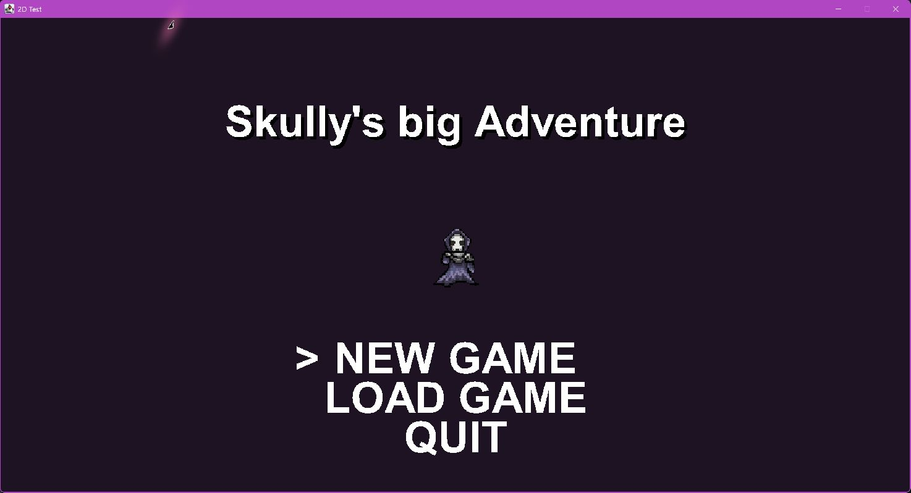
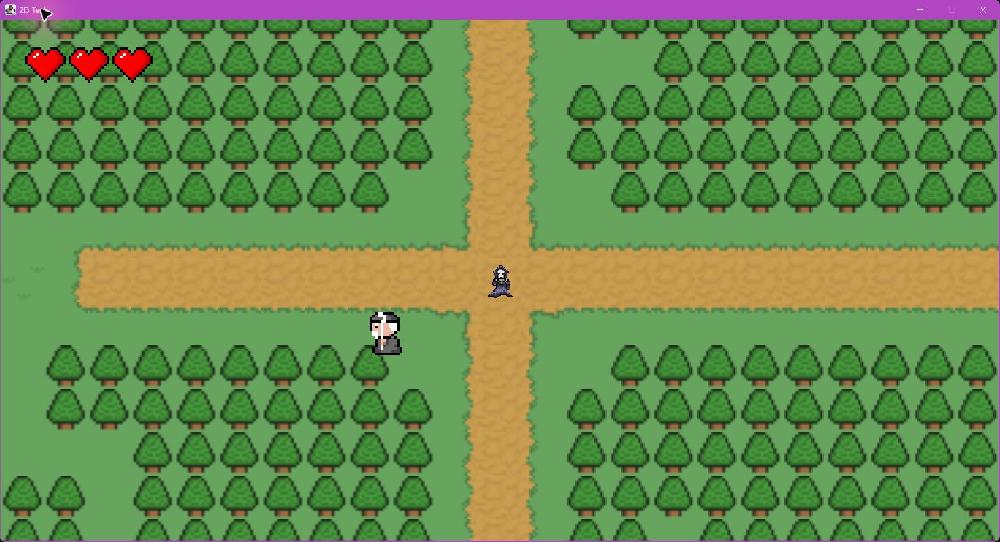
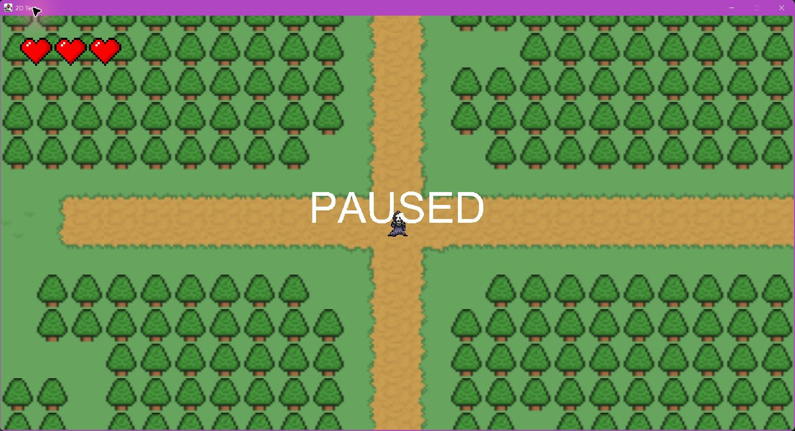
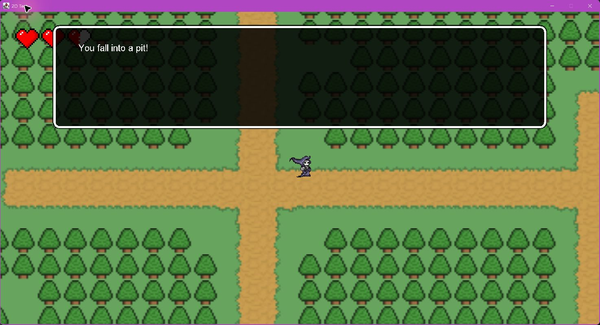
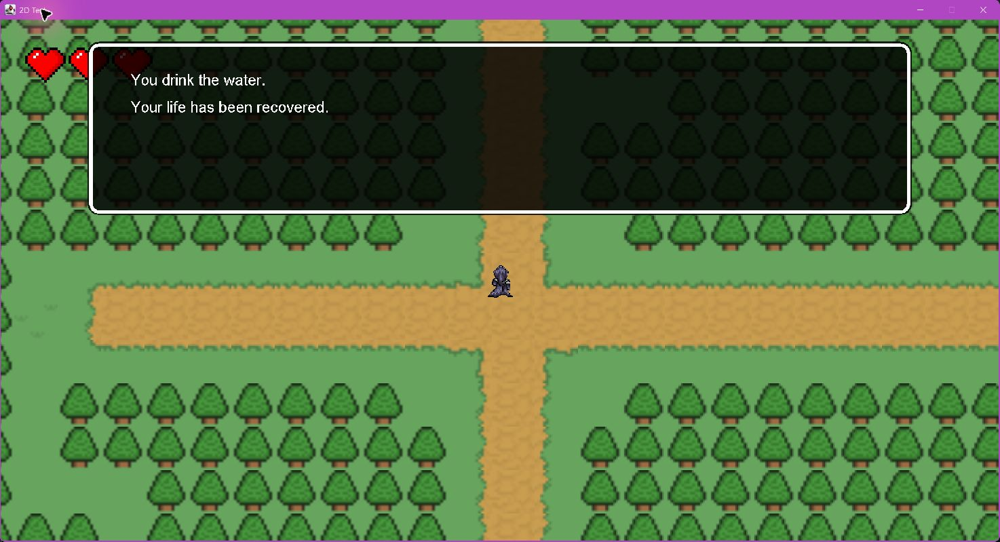
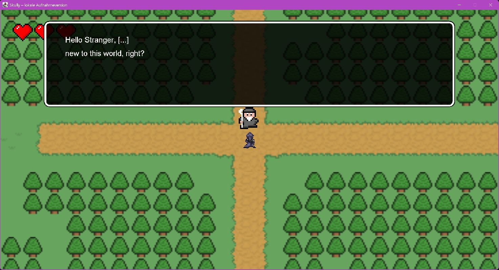
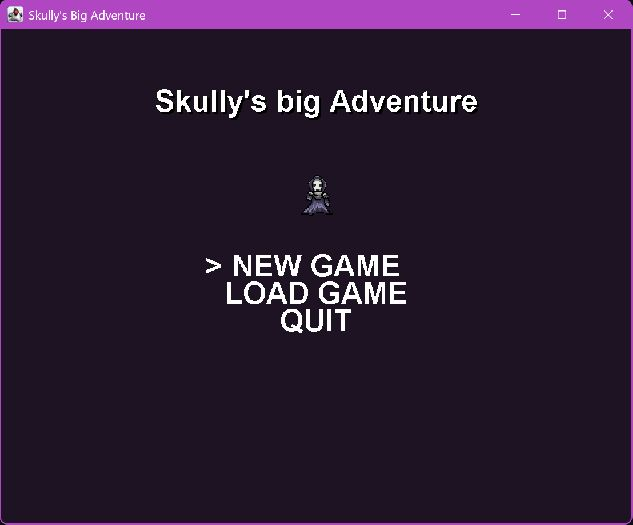
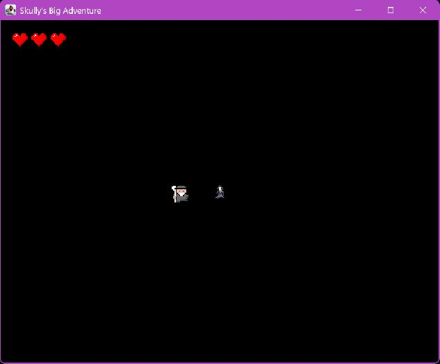

# Skully’s Big Adventure – Galerie

Spielwelt, Gespräche und Kartenereignisse. Für die NPC-Dialogaufnahme wurden Figuren positioniert und die Spielzeit angehalten. Die übrigen Bilder zeigen normale Spielläufe.

## Titelbildschirm

Das Hauptmenü des Spiels.

## Spielwelt

Waldwege, Spielfigur, NPC und Lebensanzeige.

## Pause

Das Spiel lässt sich mit Escape pausieren.

## Schaden

Ein Kartenereignis zieht Lebenspunkte ab.

## Heilung

Ein Heilereignis stellt die Lebenspunkte wieder her.

## NPC-Gespräch

Ein Gespräch mit einer Figur in der Spielwelt.

## Testversion: Titelbildschirm

Das Hauptmenü der Testversion.

## Testversion: Spielwelt

Die Testversion verwendet schwarze Platzhalterkacheln.

[Projekt und Technik](PROJEKT.md) · [Zur Übersicht](../README.md). Alle Angaben und Downloads ohne Gewähr.
