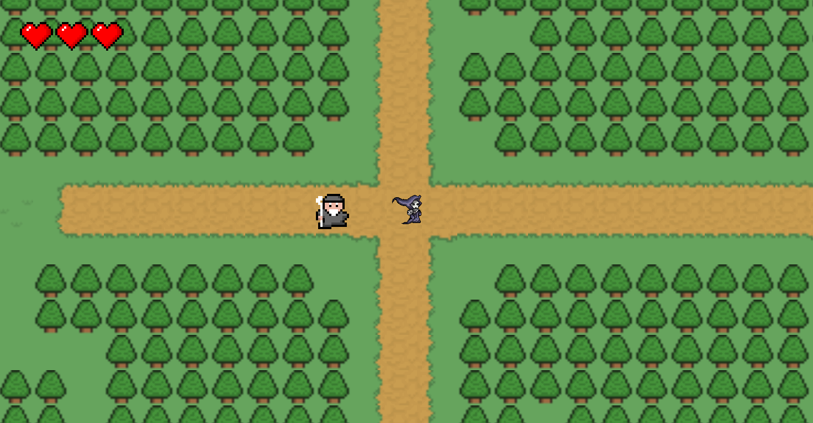
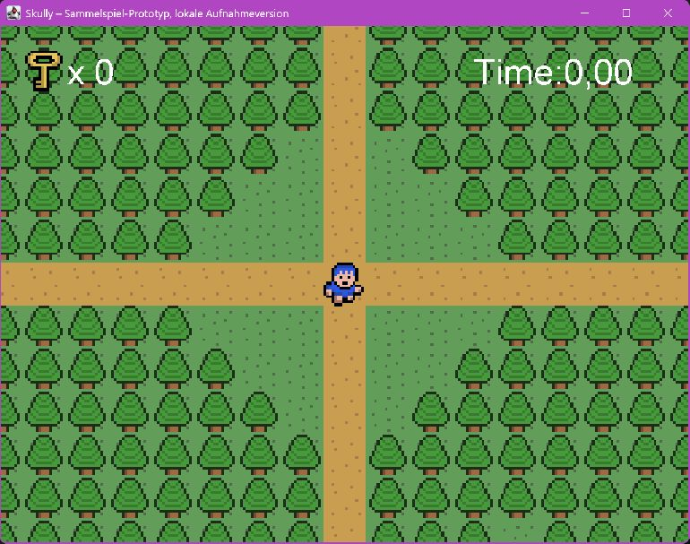
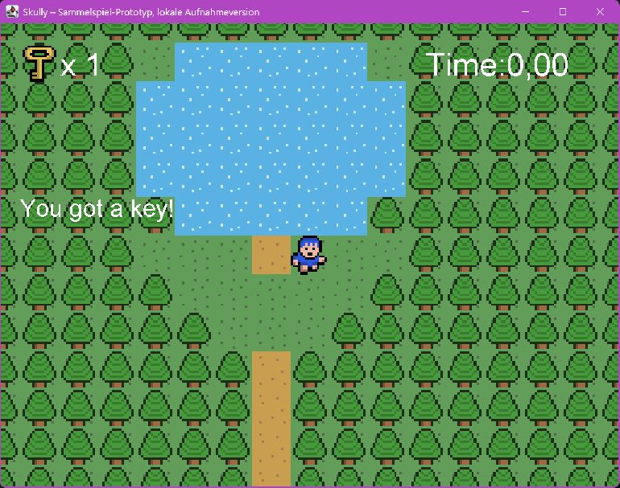
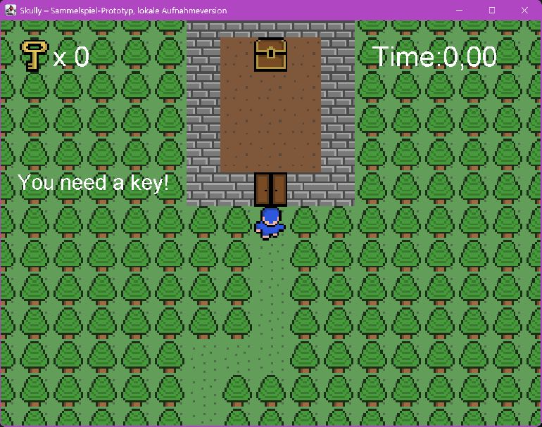
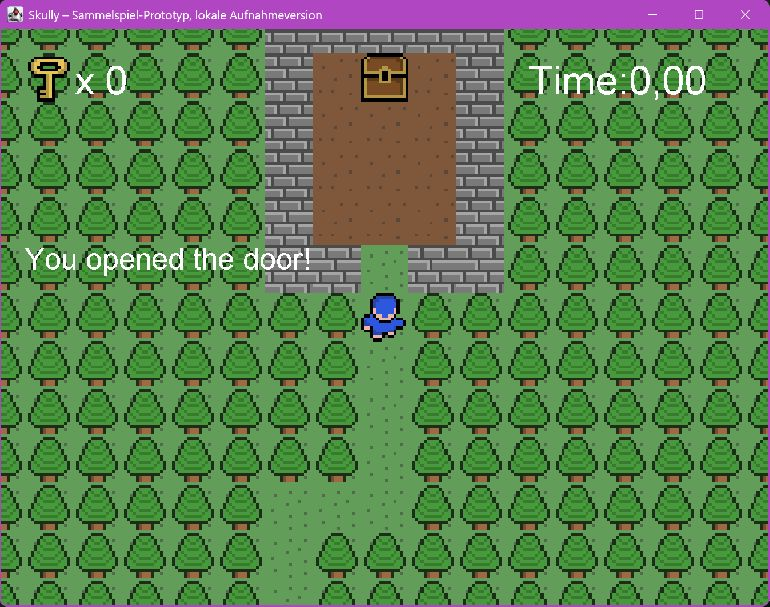
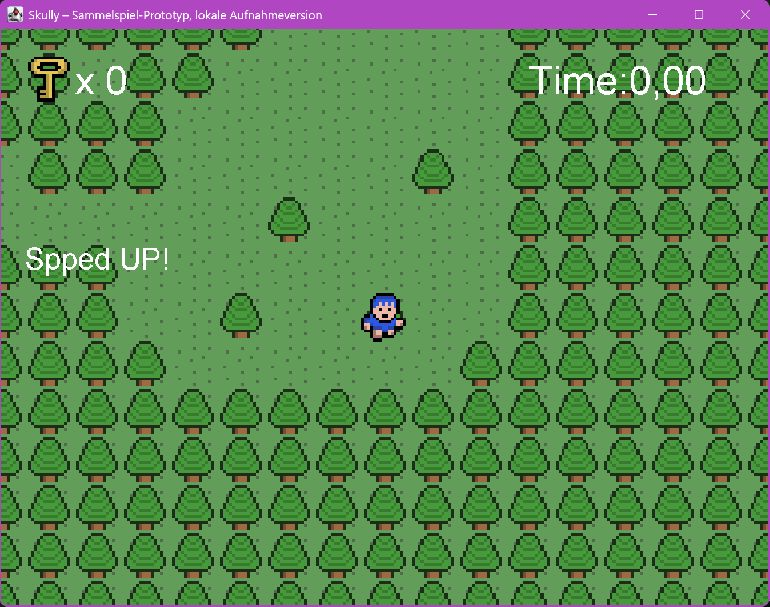
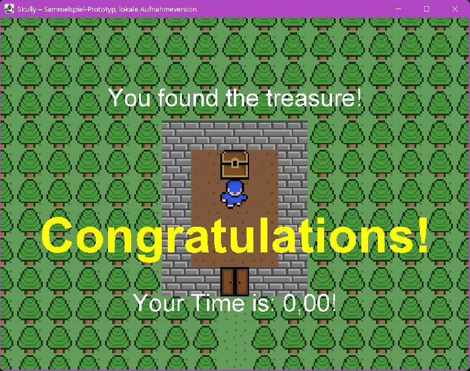

# Skully’s Big Adventure – Galerie

Spielwelt, Gespräche, Kartenereignisse und Schatzsuche. Für Dialoge und Prototypaufnahmen wurden Figuren positioniert und Abläufe gezielt ausgelöst. Die Prototyp-Zeit ist angehalten und zeigt keine erspielte Bestzeit. Die Laufanimation verwendet die vorhandene Bewegungsroutine.

## Titelbildschirm

Das Hauptmenü des Spiels.

## Spielwelt

Waldwege, Spielfigur, NPC und Lebensanzeige.

## Pause

Das Spiel lässt sich mit Escape pausieren.

## Schaden

Ein Kartenereignis zieht Lebenspunkte ab.

## Heilung

Ein Heilereignis stellt die Lebenspunkte wieder her.

## NPC-Gespräch

Ein Gespräch mit einer Figur in der Spielwelt.

## Testversion: Titelbildschirm

Das Hauptmenü der Testversion.

## Testversion: Spielwelt

Die Testversion verwendet schwarze Platzhalterkacheln.

## Laufanimation

Bewegung und Richtungswechsel in der Abenteuerwelt.

## Schatzsuche: Spielwelt

Ein Wegenetz verbindet die Orte des Sammelspiel-Prototyps.

## Schlüssel einsammeln

Der Schlüsselzähler steigt nach dem Aufnehmen.

## Verschlossene Tür

Ohne Schlüssel bleibt die Tür versperrt.

## Tür öffnen

Ein Schlüssel wird verbraucht und der Durchgang frei.

## Stiefel

Das Aufnehmen der Stiefel erhöht die Laufgeschwindigkeit. Die originale Meldung lautet „Spped UP!“.

## Schatz gefunden

Die Schatztruhe löst die Abschlussanzeige aus.

[Projekt und Technik](PROJEKT.md) · [Zur Übersicht](../README.md). Alle Angaben und Downloads ohne Gewähr.
