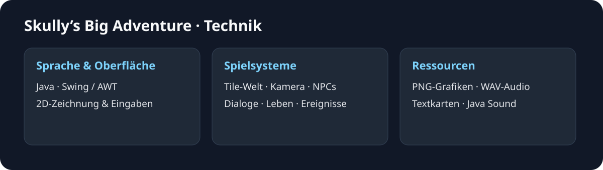

# Skully’s Big Adventure – Projekt und Technik

## Entstehung

Skully’s Big Adventure entstand 2022 als gemeinsame Projektarbeit im Abitur (TGI11). Entwickelt wurden eine Abenteuerwelt mit animierten Figuren und Dialogen sowie ein Sammelspiel-Prototyp mit Schlüsseln, Türen und Schatzsuche.

## Spiel und Technik

Das Projekt setzt ein 2D-Abenteuer mit Java, Swing und AWT um. Eine Spielschleife aktualisiert Bewegung und Darstellung. Die Welt besteht aus nummerierten Kacheln. Textdateien legen die Karte fest. Der Bildausschnitt folgt der Spielfigur. NPCs, Kollisionen, Dialoge und Ereignisse ergänzen die Bewegung. Herzen zeigen Lebenspunkte. Ein Pausenmodus hält das Spiel an.



| Bereich | Umsetzung |
| --- | --- |
| Programmstart | `src/main/Main.java` |
| Spielschleife und Zustände | `GamePanel`: Titel, Spiel, Pause und Dialog |
| Eingabe und Oberfläche | `KeyHandler`, `UI`, Swing/AWT |
| Welt | `tile/TileManager`, PNG-Kacheln, Textkarten unter `res/maps` |
| Figuren | `entity/Player`, `NPC_OldMan`, Richtungsanimationen |
| Kollisionen und Ereignisse | `CollisionChecker`, `EventHandler` |
| Audio | Java Sound, WAV-Dateien |

## Spielversionen

Die Abenteuerwelt und die Schatzsuche lassen sich getrennt starten. Beide verwenden Java, Swing und AWT. Eine weitere Testversion nutzt Platzhalterkacheln.

| Ordner oder Datei | Inhalt |
| --- | --- |
| `Projekt/My2DGame` | Spielversion mit Gras, Wegen, Wasser und Bäumen |
| `My2DGame(Test)` | Testversion mit Platzhalterkacheln |
| `game/My2DGame` | Spielbare Schatzsuche mit Schlüsseln, Türen, Stiefeln und Schatztruhe |
| `skullys-big-adventure.jar` | Startet die Testversion |

## Kompilieren und starten

Die Spiel- und Testversion lassen sich mit **Temurin JDK 21.0.13+9 unter Windows** kompilieren. Für die Spielversion die folgenden PowerShell-Befehle im Projektordner ausführen. `javac` und `java` müssen erreichbar sein.

```powershell
$project = Join-Path (Get-Location) 'Projekt/My2DGame'
$classes = Join-Path ([IO.Path]::GetTempPath()) 'skully-graphic-classes'
New-Item -ItemType Directory -Force -Path $classes | Out-Null
$sources = @(Get-ChildItem -LiteralPath "$project/src" -Recurse -Filter *.java | ForEach-Object FullName)
javac -proc:none -encoding UTF-8 -d $classes @sources
java -cp "$classes;$project/res" main.Main
```

Für die **Schatzsuche** im obigen Befehl `$project` auf `Join-Path (Get-Location) 'game/My2DGame'` setzen und als Ausgabeverzeichnis beispielsweise `skully-prototype-classes` verwenden. Dieser Prototyp startet direkt in die Welt.

Die **Testversion** lässt sich direkt über die JAR-Datei starten:

```text
java -jar skullys-big-adventure.jar
```

Die Testversion verwendet schwarze Platzhalterkacheln. Sie ist in der [Galerie](GALERIE.md) zusätzlich zur Spielversion zu sehen.

## Bedienung und Ereignisse

| Eingabe | Aktion |
| --- | --- |
| Enter | NEW GAME starten und Dialog verlassen |
| W/A/S/D | Bewegung |
| F | Gespräche und Heilung |
| Escape | Pause ein-/ausschalten |

In der Spielversion löst Kachel (25, 21) mit Blickrichtung rechts ein Schadensereignis aus. Bei (23, 21) kann sich die Figur mit Blickrichtung oben und F heilen. In der Testversion liegt die Heilposition bei (24, 8).

Die Schatzsuche verwendet W/A/S/D und beginnt ohne Titelmenü. Drei Schlüssel öffnen drei Türen. Jeder geöffnete Durchgang verbraucht einen Schlüssel. Die Stiefel erhöhen die Bewegungsgeschwindigkeit von 4 auf 6 Pixel pro Update. Die Schatztruhe beendet den Durchlauf mit einer Abschlussanzeige. Diese Objektinteraktionen gehören zum Prototyp, während die Abenteuerwelt NPCs, Dialoge und Lebenspunkte in den Mittelpunkt stellt.

## Bilder

Die [Galerie](GALERIE.md) zeigt die Laufanimation, Spielwelt, Dialoge, Pause, Schaden, Heilung und die Objektfolge der Schatzsuche. Die Dialog- und Prototypaufnahmen verwenden positionierte Figuren und angehaltene Zeit. Die Animation zeigt die vorhandene Bewegungsroutine. Die Zeitanzeige im Prototyp ist kein Spielergebnis.

[Zur Projektübersicht](../README.md). Alle Angaben und Downloads ohne Gewähr.
